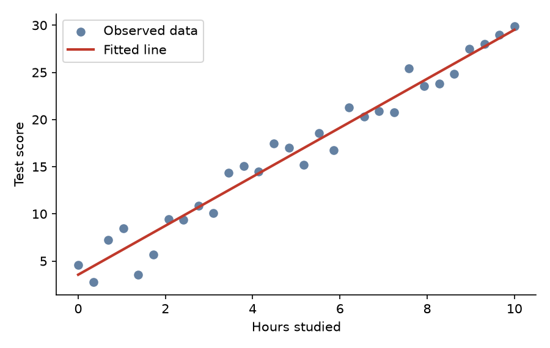

# 1A: Decision boundaries

A **decision boundary** is the line (or surface) where a classifier switches from one label to another. Points on one side receive one label; points on the other side receive the other.

```{admonition} In development
:class: caution
This page is a first draft. Worked examples and a notebook will be added on a separate branch and reviewed through a pull request.
```

## Example



TODO: replace this with a classification example.

#### Notes for reviewers

This page jumps straight to a lower heading level.
